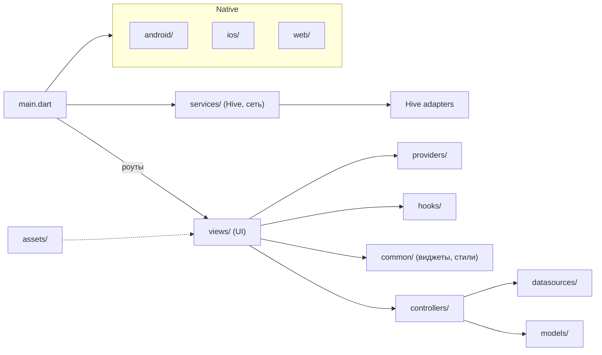

# БОКОН

Приложение «БОКОН» — Flutter-клиент с локальным кэшированием и набором экранов: каталог, статьи, профиль и просмотр фотографий.

**Краткое описание**
- Точка входа: `lib/main.dart` — `GetMaterialApp` с маршрутами и `SplashScreen` как стартовым экраном.
- Локальное хранилище: Hive (адаптеры в `lib/services/`).
- Архитектура: разделение на `views` (UI), `controllers` (состояние/логика), `services` (инфраструктура), `models` (DTO), `datasources` (источники данных), `hooks` (flutter_hooks) и `common` (повторно используемые виджеты).

**Диаграмма модулей**


**Ключевые директории и файлы**
- `lib/` — основной код приложения.
	- `lib/main.dart` — точка входа и маршрутизация.
	- `lib/views/` — экраны по фичам: `home`, `splash`, `articles`, `errors` (каталог), `profile`, `photoviewer`.
	- `lib/controllers/` — контроллеры бизнес-логики.
	- `lib/services/` — `hive_service.dart`, `img_network.dart` и сгенерированные адаптеры `hive_adapters.g.dart`.
	- `lib/models/` — модели данных (категории, позиции каталога, статьи, профиль).
	- `lib/hooks/` — кастомные хуки для загрузки/кэширования данных.
	- `lib/common/` — общие виджеты и стили (AppBar, шимер-виджеты и т.д.).
- `assets/` — статические ресурсы: `images/`, `json/` (каталог данных).
- `pubspec.yaml` — зависимости и конфигурация (GetX, Hive, Dio, flutter_hooks и др.).

**Зависимости (важные)**
- Управление состоянием и навигация: `get`
- Локальное хранилище: `hive_ce` (+ генератор `hive_ce_generator`)
- Хуки: `flutter_hooks`
- Сеть: `dio`, `http`
- Изображения: `cached_network_image`, `photo_view`

**Команды для разработки**
Убедитесь, что у вас установлен Flutter (версию см. в `pubspec.yaml`) и выполнен `flutter doctor`.

Быстрая последовательность:
```bash
# проверить окружение
flutter doctor

# получить зависимости
flutter pub get

# при изменениях моделей Hive — сгенерировать адаптеры
flutter pub run build_runner build --delete-conflicting-outputs

# очистить сборку (при проблемах)
flutter clean

# запустить на подключённом устройстве/эмуляторе
flutter run
```

Сборки и платформы:
```bash
# Android — APK
flutter build apk --release

# Android — App Bundle (для Play Store)
flutter build appbundle --release

# iOS — подготовка (macOS + Xcode)
flutter build ipa --release
# или открыть Xcode для подписи
open ios/Runner.xcworkspace

# Web (локально)
flutter run -d chrome

# Анализ и тесты
flutter analyze
flutter test
```

Приметки:
- Для сборки iOS требуется macOS и корректная настройка профилей подписи в Xcode.
- Если добавляете новые Hive-модели — обновите `TypeAdapter` и прогоните `build_runner`.
- Для обновления ассетов убедитесь, что они перечислены в `pubspec.yaml` и выполните `flutter pub get`.

**Советы и примечания**
- Файлы в `build/` — сгенерированные артефакты, не редактировать.
- Локальные JSON-ресурсы `assets/json/*.json` используются как источник для каталога; проверьте соответствие моделей в `lib/models/`.
- Если добавляете новые модели для Hive — не забудьте добавить `TypeAdapter` и прогнать `build_runner`.
